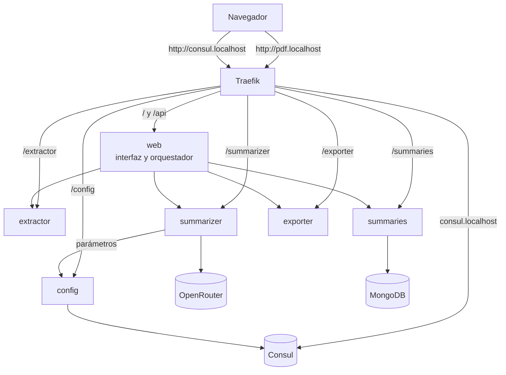
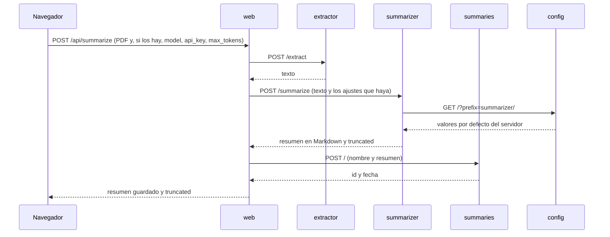

# Arquitectura de pdf-extractext

## Microservicios

Cada servicio hace una sola cosa, vive en su propio repositorio y corre en su propio
contenedor. Se comunican por HTTP dentro de la red de Docker.



| Servicio | Responsabilidad | Única dependencia externa |
|---|---|---|
| **web** | Sirve la interfaz (portada y página Ajustes) y coordina a los demás | Los otros cuatro servicios |
| **extractor** | Extrae el texto de un PDF | `pypdf` |
| **summarizer** | Genera el resumen | OpenRouter; usa la API key del `.env` o la que le llega en la petición |
| **summaries** | Guarda, lista, consulta y borra resúmenes | MongoDB; es el único que lo toca |
| **exporter** | Convierte el Markdown en un `.docx` | `python-docx` y `markdown-it-py` |
| **config** | CRUD de la configuración centralizada | Consul (`py-consul`); es el único que lo toca |

### Traefik

Traefik es la **única puerta de entrada** y lo único que publica puertos en la máquina
(80 para la aplicación, 8080 para su panel). Enruta por prefijo y lo quita antes de
reenviar: `/extractor/health` llega al extractor como `/health`, así que ningún
servicio sabe que existe Traefik. Descubre los servicios leyendo las etiquetas de sus
contenedores en el `docker-compose.yml`.

Entre ellos, los servicios se hablan por la red interna (`http://extractor:8000`), sin
pasar por Traefik.

### MongoDB

Solo `summaries` habla con MongoDB. Si otro servicio necesita un resumen, se lo pide a
`summaries` por HTTP. Mongo arranca con usuario y contraseña, no publica su puerto y
guarda los datos en un volumen de Docker.

### Consul y config

Consul guarda la **configuración del servidor** en su KV: el modelo por defecto, el
máximo de tokens, la temperatura y el truncado del texto, bajo
`pdf-extractext/summarizer/...`. Es un único servidor que se elige líder a sí mismo,
no publica puertos y guarda sus datos en un volumen.

Solo `config` habla con Consul, con `py-consul`. Si otro servicio necesita un valor,
se lo pide a `config` por HTTP: `summarizer` lo hace en cada resumen, así que un cambio
vale sin reiniciar nada. Si `config` no responde, `summarizer` usa su `.env`.

En el KV **no se guardan secretos**: va sin ACL y en texto plano. Las API keys están en
el `.env` o en el navegador de cada usuario.

## Flujo de una petición: subir un PDF



Si un paso falla, los siguientes no se ejecutan: un PDF sin texto no llega a la IA, y
si la IA falla no se guarda nada. El mensaje del servicio que falló llega tal cual al
usuario. Si un servicio no responde, `web` devuelve `502` diciendo cuál; si tarda
demasiado, `504`.

Los ajustes del usuario (`model`, `api_key`, `max_tokens`) solo viajan si los eligió y
no se guardan en `summaries`. Si el modelo se queda sin tokens, el resumen llega con
`truncated: true` y la interfaz avisa de que está incompleto.

## Valores de cada resumen y página Ajustes

Cada valor se resuelve en tres niveles; gana el primero que exista:

```
1. Ajustes del usuario     página Ajustes, en su navegador     modelo, API key, máximo de tokens
2. Configuración central   Consul, a través de config          modelo, tokens, temperatura, truncado
3. .env de summarizer      respaldo                            todo, incluida la API key del servidor
```

- La **página Ajustes** se abre con el botón ⚙️ del panel del resumen. Permite elegir
  el modelo, añadir modelos propios con su API key, cambiar el máximo de tokens y
  volver a los valores del servidor.
- Lo que elige el usuario se guarda en el `localStorage` de su navegador: la app no
  tiene usuarios, y en el servidor cualquiera vería las claves de los demás.
- Ajustes **muestra** los valores del servidor (de `/summarizer/parameters`) pero
  **nunca los cambia**: sin login, cualquier visitante cambiaría los de todos. Se
  cambian con `/config` o con la interfaz de Consul.
- `summarizer` pone un tope al `max_tokens` que pide el usuario (`MAX_TOKENS_LIMIT`),
  para proteger la cuota de la clave del servidor.

## Capas dentro de cada servicio

Los seis servicios siguen la misma estructura:

| Capa | Carpeta | Contiene |
|---|---|---|
| Presentación | `app/presentation/` | Routers y schemas de FastAPI |
| Aplicación | `app/application/` | Casos de uso, puertos (interfaces) y entidades. No importa librerías externas |
| Infraestructura | `app/infrastructure/` | Adaptadores de los puertos: `pypdf`, OpenRouter, MongoDB, `python-docx`, Consul, clientes HTTP |
| Configuración | `app/core/` | `Settings`, leído de variables de entorno |
| Cableado | `app/dependencies.py` | Construye las dependencias. Lo importan los routers y `main`, así que no hay import circular |

Las dependencias apuntan hacia dentro: la infraestructura implementa los puertos que
define la aplicación. Por eso los tests sustituyen cada adaptador por un doble y corren
sin red, sin base de datos y sin API key.

## Decisiones

- **Un repositorio por servicio** y uno más para la orquestación: cada servicio se
  prueba, se construye y se publica por separado.
- **Comunicación por HTTP síncrono.** Una cola de mensajes añadiría infraestructura
  sin que el flujo la necesite.
- **`web` como orquestador (BFF).** El navegador no conoce la topología ni encadena
  llamadas.
- **Las reglas de Traefik viven en el `docker-compose.yml`**, no en los servicios.
- **Traefik v3.6.** La v3.5 no detecta servicios con Docker Engine 29.
- **Proveedor de IA: OpenRouter.** Sustituyó a NVIDIA NIM porque se accede con una
  simple API key, sin hardware propio, y ofrece modelos gratuitos. Cambiar de
  proveedor solo exige otra implementación del puerto `AIProvider` en `summarizer`.
- **Configuración centralizada en Consul, a través de `config`** (épica #74). Solo un
  servicio conoce `py-consul`; los demás lo consultan por HTTP y, si no responde, usan
  su `.env`. El compose de ejemplo del profesor arrancaba un agente sin servidor ni
  `-client`, así que el KV no funcionaba: aquí corre con
  `agent -server -bootstrap-expect=1 -client=0.0.0.0`.
- **Ajustes del usuario en su navegador, no en el servidor** (épica #72): sin usuarios
  ni login, es la única forma de que cada persona solo vea sus claves.
- **El monolito anterior** se conserva en la etiqueta `monolito-v1` de este repositorio.
